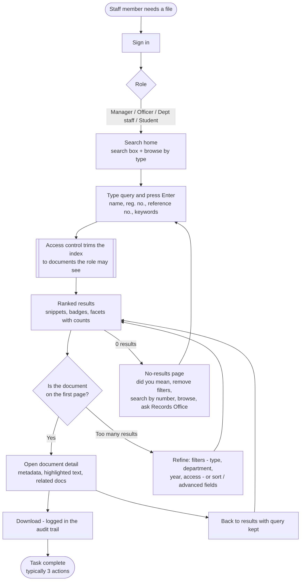

# 3. User flow: from query to document

*(Source: [`user-flow.mmd`](user-flow.mmd), Mermaid.)*

## Main path: 3 actions

| Step | User action | System response |
|---|---|---|
| 0 | Signs in | Loads the role, department and registration number used by access control |
| 1 | Types `Brian Okello transcript` in the search box (already focused) | — |
| 2 | Presses **Enter** | Parses and analyses the query, looks up the inverted index, keeps only the documents the role may see, ranks them with BM25, counts facets, builds snippets, and logs the search |
| 3 | Clicks the first result | Checks access again, logs the click (rank 1) and the view, and shows the metadata, the highlighted text and related documents |
| (4) | Clicks **Download** | Checks access, writes an audit entry, and streams the file (or a text export) |

## Alternative paths

| Situation | Path | Extra actions |
|---|---|---|
| Too many results | Tick a facet (e.g. *Admission Letter*) or change the sort | +1 per filter |
| Known reference or registration number | Type or paste it, e.g. `LU/HR/2023/0042` → exact match at rank 1 | 0 |
| Misspelling | No-results page → **Did you mean …?** | +1 |
| Nothing found | Remove filters → reformulate → browse by type → email the Records Office | +1 to +3 |
| Comparing candidates | Open a result → **Back to results** (query, filters and page kept) → open the next one | +2 per candidate |
| Prefers French | Click **FR** in the header: the same page, query and results are shown in French (titles, snippets, metadata, download) | +1 (once) |
| Forbidden document (e.g. guessed URL) | Generic "does not exist or not authorised" page; the refusal is written to the audit log | — |

The Evaluation page counts the steps for each test query. The average is **3.2 actions** from typing the query to opening the right document.
