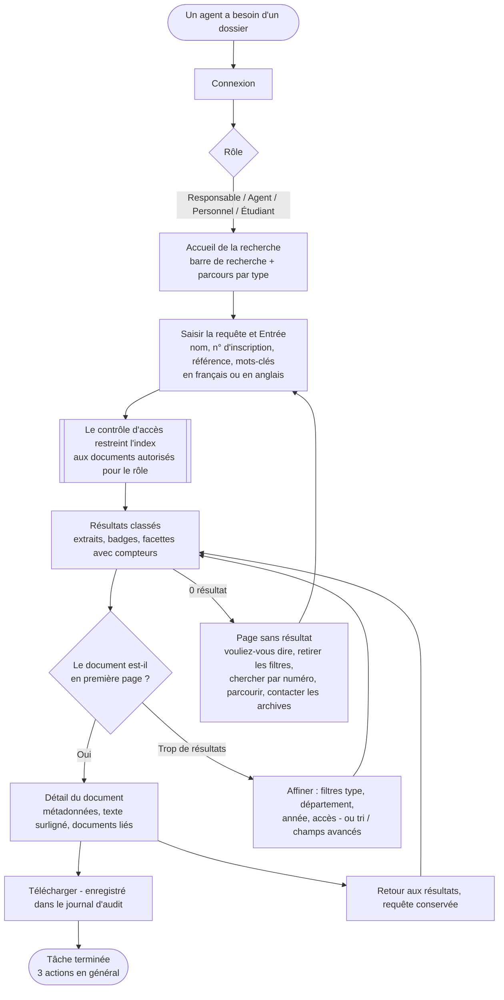
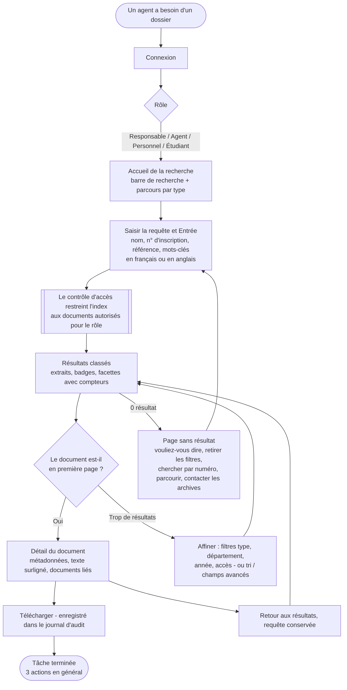

# 3. Parcours utilisateur : de la requête au document

*(Source : [`parcours-utilisateur.mmd`](parcours-utilisateur.mmd), Mermaid. Version anglaise : [`../user-flow.png`](../user-flow.png).)*

## Parcours principal : 3 actions

| Étape | Action de l'utilisateur | Réponse du système |
|---|---|---|
| 0 | Se connecte | Charge le rôle, le département et le numéro d'inscription utilisés par le contrôle d'accès, ainsi que la langue choisie |
| 1 | Saisit `relevé de notes Brian Okello` dans la barre de recherche (déjà active) | — |
| 2 | Appuie sur **Entrée** | Analyse la requête, interroge l'index inversé, ne garde que les documents autorisés pour le rôle, les classe avec BM25, compte les facettes, construit les extraits dans la langue choisie et enregistre la recherche |
| 3 | Clique sur le premier résultat | Vérifie à nouveau l'accès, enregistre le clic (rang 1) et la consultation, puis affiche les métadonnées, le texte surligné et les documents liés |
| (4) | Clique sur **Télécharger** | Vérifie l'accès, écrit une entrée d'audit et transmet le fichier original (ou un export texte dans la langue choisie) |

## Parcours alternatifs

| Situation | Parcours | Actions en plus |
|---|---|---|
| Trop de résultats | Cocher une facette (par ex. *Lettre d'admission*) ou changer le tri | +1 par filtre |
| Référence ou numéro d'inscription connu | Le saisir ou le coller, par ex. `LU/HR/2023/0042` → correspondance exacte au rang 1 | 0 |
| Faute de frappe | Page sans résultat → **Vouliez-vous dire … ?** | +1 |
| Rien n'est trouvé | Retirer les filtres → reformuler → parcourir par type → écrire au Service des archives | +1 à +3 |
| Comparer des candidats | Ouvrir un résultat → **Retour aux résultats** (requête, filtres et page conservés) → ouvrir le suivant | +2 par candidat |
| Préfère l'anglais | Cliquer **EN** dans l'en-tête : la même page, la même requête et les mêmes résultats s'affichent en anglais | +1 (une seule fois) |
| Document interdit (par ex. adresse devinée) | Page générique « n'existe pas ou non autorisé » ; le refus est inscrit au journal d'audit | — |

La page Évaluation compte les étapes de chaque requête de test. La moyenne est de **3,2 actions** entre la saisie de la requête et l'ouverture du bon document, en français comme en anglais.
